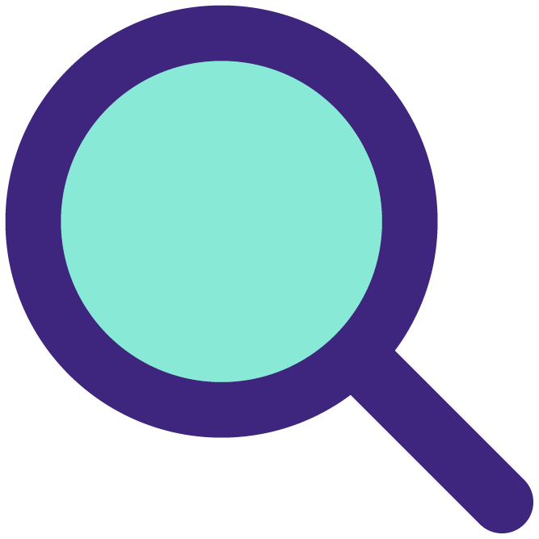
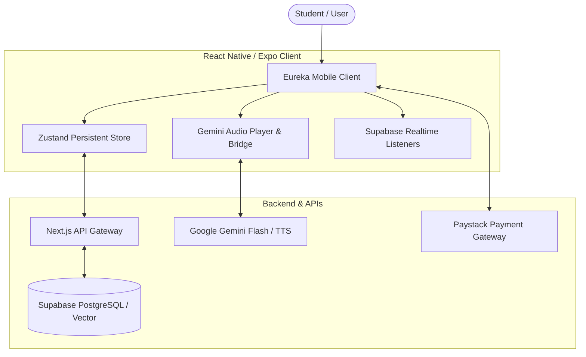

<div align="center">



# Eureka AI Mobile

**Your personal, adaptive AI study companion and live voice lecturer.**

[](https://expo.dev/)
[](https://reactnative.dev/)
[](https://www.typescriptlang.org/)
[](https://supabase.com/)
[](https://ai.google.dev/)
[](./LICENSE)

<br />

<p align="center">
  <a href="#key-features">Key Features</a> •
  <a href="#system-architecture">Architecture</a> •
  <a href="#tech-stack">Tech Stack</a> •
  <a href="#getting-started">Getting Started</a> •
  <a href="#building-with-eas">EAS Build</a> •
  <a href="#contributing">Contributing</a>
</p>

---

</div>

## Overview

**Eureka AI Mobile** transforms academic notes, lecture slides, and study guides into an interactive, voice-driven learning experience. It pairs deep retrieval-augmented note comprehension with a conversational AI lecturer capable of speaking explanations, quizzing students, and adapting complexity from beginner foundations to advanced exam preparation.

---

## Key Features

### 🎙️ Live Conversational AI Lecturer
- **Gemini Neural TTS & Voice Bridge**: Natural speech synthesis with customizable voices (Puck, Charon, Aoede, Fenrir, Kore) and playback speed controls.
- **Segmented Long-Form Speech**: Automatically breaks multi-paragraph AI explanations into smooth, pre-buffered audio segments without native text clipping limits.
- **True Pause & Resume**: Audio bridge maintains exact playback position without resetting to the beginning.
- **ChatGPT-Style Voice Interaction**: Speak your questions naturally using your phone's built-in OS speech-to-text dictation or quick prompt shortcuts.
- **Session History & Continuity**: All voice lectures and interactive Q&A exchanges persist to your account so you can review previous transcripts anytime.

### 📚 Context-Aware AI Study Chats
- **Note-Anchored Conversations**: Chat directly against specific study documents or start general academic deep-dives.
- **Instant Local Caching**: Screen opens instantly with zero loading spinners, syncing conversation updates seamlessly in the background.
- **Formatted Markdown & LaTeX**: Clear rendering for mathematical expressions, code blocks, lists, and hierarchical headers.

### 🔔 Real-Time Notifications
- **Supabase Realtime Sync**: Document parsing completions, study reminders, and system alerts push instantly without manual polling.
- **Smart Deep Linking**: Tapping any alert routes you directly to the relevant note or lecture session.

### 💳 Tiered Subscriptions & Paystack Checkout
- **In-App Payment Flow**: Seamless, secure Paystack integration for upgrading to Student Pro and Premium Power tiers.
- **Accurate Plan State**: Dynamic badge tracking that protects active subscribers from redundant charges or accidental plan downgrades.

---

## System Architecture



---

## Tech Stack

| Domain | Technology |
|---|---|
| **Framework** | [React Native 0.76](https://reactnative.dev/) with [Expo SDK 52](https://expo.dev/) (New Architecture ready) |
| **Routing** | [Expo Router](https://docs.expo.dev/router/introduction/) (File-based navigation) |
| **Language** | [TypeScript](https://www.typescriptlang.org/) (Strict type checking) |
| **State Management** | [Zustand](https://github.com/pmndrs/zustand) with SecureStore / AsyncStorage persistence |
| **Audio & Speech** | Custom Headless WebView WebAudio Bridge + Google Gemini Speech TTS API |
| **Auth & Database** | [Supabase](https://supabase.com/) (Auth, PostgreSQL database, Realtime channel events) |
| **Payments** | [Paystack](https://paystack.com/) via embedded in-app WebView integration |
| **UI Components** | Lucide React Native, Custom Design Tokens, Theme Engine (Light/Dark mode) |

---

## Getting Started

### Prerequisites

- [Node.js](https://nodejs.org/) (v18.x or v20.x recommended)
- [npm](https://www.npmjs.com/) or [yarn](https://yarnpkg.com/)
- [Expo Go](https://expo.dev/go) on your physical mobile device, or Android Studio / Xcode emulators.

### Installation

1. **Clone the repository:**
   ```bash
   git clone https://github.com/TECHTUNE-I-T-SOLUTIONS/eurekamobile.git
   cd eurekamobile
   ```

2. **Install project dependencies:**
   ```bash
   npm install
   ```

3. **Configure Environment Variables:**
   Copy the sample environment file:
   ```bash
   cp .env.example .env.local
   ```
   Fill in your service credentials:
   ```env
   EXPO_PUBLIC_SUPABASE_URL=https://your-project.supabase.co
   EXPO_PUBLIC_SUPABASE_ANON_KEY=your-anon-key
   EXPO_PUBLIC_API_BASE_URL=https://eureka.vercel.app/api
   EXPO_PUBLIC_GEMINI_API_KEY=your-gemini-api-key
   ```

4. **Start the development server:**
   ```bash
   npx expo start
   ```
   - Press `a` to open on an Android emulator.
   - Press `i` to open on an iOS simulator.
   - Scan the QR code using **Expo Go** on Android or Camera on iOS.

---

## Building with EAS

This project is configured with [Expo Application Services (EAS)](https://expo.dev/eas) for automated cloud builds and push notification credentials.

### 1. Authenticate with EAS
```bash
npx eas login
```

### 2. Initialize / Link Project
```bash
npx eas init --id
```
Select the **`techtune-i-t-solutions`** account when prompted.

### 3. Build Android Preview APK (No Expo Go limits)
```bash
npx eas build --platform android --profile preview
```

### 4. Build Production Binaries
```bash
# Android App Bundle (AAB) for Google Play
npx eas build --platform android --profile production

# iOS Archive (IPA) for App Store / TestFlight
npx eas build --platform ios --profile production
```

---

## Directory Structure

```text
eurekamobile/
├── app/                      # Expo Router screen routes
│   ├── (auth)/               # Authentication (Login, Register, Forgot Password)
│   ├── (tabs)/               # Bottom tab navigation
│   │   ├── index.tsx         # Dashboard / Home
│   │   ├── notes.tsx         # Notes management & study materials
│   │   ├── lecturer.tsx      # Interactive AI Voice Lecturer & Live Voice Modal
│   │   ├── chat.tsx          # AI study conversations history
│   │   └── profile.tsx       # User preferences, voice settings & account
│   ├── chat/[id].tsx         # Dynamic chat conversation thread
│   ├── notes/[id].tsx        # Note reader & contextual study view
│   ├── notifications/        # User notifications center
│   └── subscription.tsx      # Tier upgrades & Paystack payment modal
├── assets/                   # App icons, splash screens, and illustrations
├── src/
│   ├── components/           # Reusable UI controls, cards, audio players
│   ├── context/              # Authentication & Theme contexts
│   ├── services/             # Supabase client, Audio Player, API services
│   ├── store/                # Zustand global application store
│   └── types/                # Database & TypeScript definitions
├── app.json                  # Expo project manifest & configuration
├── eas.json                  # EAS cloud build configurations
└── tsconfig.json             # TypeScript configuration
```

---

## Security & Best Practices

- **Never commit `.env` or `.env.local` files** containing sensitive secrets or production keys.
- Authorization tokens are held in encrypted device storage (`expo-secure-store`) on native platforms.
- Push notification server secrets and Google Service Account credentials should be added through EAS Secrets (`npx eas secret:create`).

---

## License

This project is licensed under the MIT License — see the [LICENSE](./LICENSE) file for details.

<br />

<div align="center">
  <sub>Built with care by <b>Techtune I.T Solutions</b></sub>
</div>
